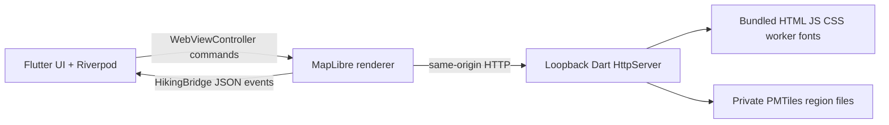

# Architecture

## Runtime path

Flutter owns permissions, GPS, future downloads, region storage, and lifecycle. TypeScript owns the map camera, vector styling, and terrain. The bridge sends small JSON commands (`zoomIn`, `zoomOut`, `resetBearing`, `toggleTerrain`, `flyTo`) and events (`ready`, `camera`, `error`). Camera events are logged for now; persistent map state can be added later. No map resources are fetched from the network.

## Local HTTP resource boundary

`LocalResourceServer` binds `InternetAddress.loopbackIPv4` on an ephemeral port. Each launch uses a random path token. It checks the Host header, permits only GET and HEAD, and serves only keys in Flutter's bundled asset manifest or strict `regions/<id>/(map|terrain).pmtiles` paths. Region files are resolved through symlinks and rejected if their final path is outside the private regions directory. The server supplies MIME types, `nosniff`, a Content Security Policy for the HTML page, and single byte range responses (`206` / `416`) needed by PMTiles. WebView navigation is restricted to the server origin and token path. Android's network security config permits cleartext only for loopback.

The token and loopback binding limit accidental exposure; they are not a substitute for validating imported region data. A future installer must verify archives and manifest metadata before making a region visible. `manifest.json` is parsed and bounded by the server; it does not supply arbitrary URLs or paths to the renderer.

## Offline rendering

Vite builds MapLibre GL JS, the MapLibre worker, PMTiles protocol, CSS, and Noto Sans WOFF2 font subsets into `assets/renderer/`. No sprite sheet is needed yet because the initial style uses lines, circles, fills, and text; adding icons requires bundling a local sprite. Labels use MapLibre's local `font-faces` support, without a glyph server. The checked-in build output allows Flutter builds without npm access.

The renderer reads a local `/config.json` generated by the server. If a region exists, it opens vector PMTiles using the PMTiles custom protocol. If a DEM PMTiles exists, it adds a `raster-dem` source and calls `setTerrain`, producing a terrain mesh. Without a region, it presents an explicit empty state. The first region in name order is displayed; region selection is future work. The style expects the OpenMapTiles layer schema listed in `README.md`. Data producers must preserve OSM attribution and any DEM attribution and verify redistribution rights.

## State and platform direction

Riverpod currently manages asynchronous startup and disposal of the local server. GPS is requested only when the user taps the location control. `sensors_plus` is declared for a later opt-in orientation camera mode; no sensor stream runs yet. The architecture keeps platform code in Flutter and the renderer in TypeScript, so iOS can reuse the same map bundle and bridge when its platform project and local network allowances are added.

Future offline search should use SQLite FTS5 in the Flutter layer, with region-scoped indexes installed and deleted atomically alongside PMTiles. No search index or database is included in this milestone. Region downloads and deletes need a catalog, explicit attribution and license metadata, checksum validation, atomic staging, free-space checks, and resumable error handling. There is no account, telemetry, backend, or API key in the current runtime.

## Verification boundary

`npm run bundle:app` typechecks and builds the TypeScript renderer. The Flutter and Android build and HTTP behavior require a Flutter SDK, Android SDK, and an emulator or device. In particular, Android WebView WebGL, the loopback cleartext rule, local font rendering, PMTiles range behavior, and real terrain archives remain device integration checks.

